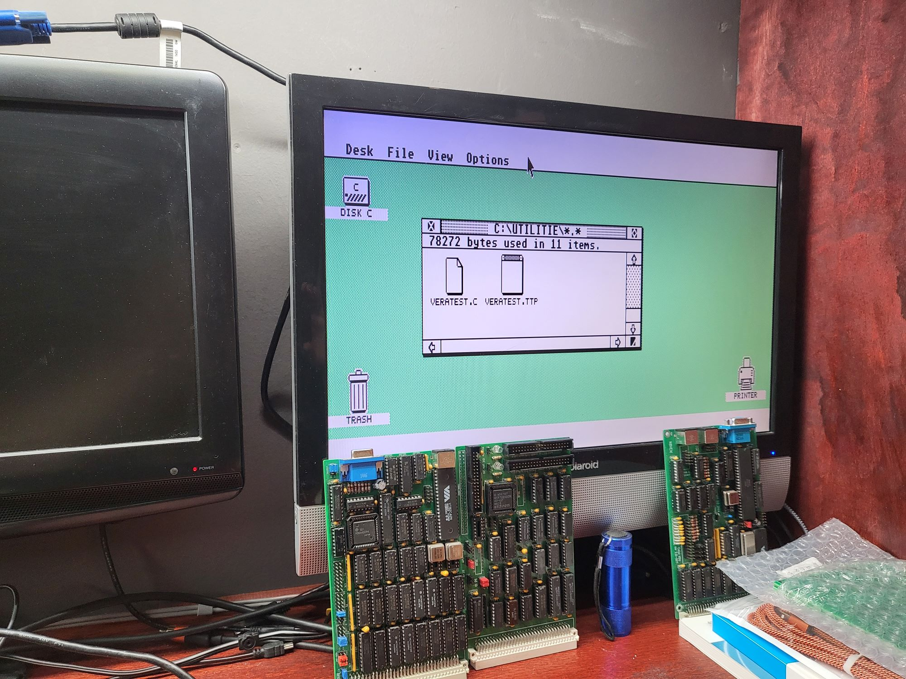

# EmuTOS for the RetroBrew Mini-M68k

This repository is a port of [EmuTOS](https://emutos.sourceforge.io/) 1.4, the free, open-source TOS-compatible operating system, to the [RetroBrew Computers](https://www.retrobrewcomputers.org/) **Mini-M68k**, an MC68008 CPU board for the ECB bus.

EmuTOS boots on the board from a CF card and runs the GEM desktop on a VERA video card, in all three Atari ST resolutions, with a PS/2 mouse and keyboard. Without the desktop it runs the EmuCON command shell over the serial console. It reads and writes FAT disks on the CF, SD and floppy boards listed below. TOS programs that use GEM or the console run, including the Sozobon C compiler, which builds programs on the board itself.



*The EmuTOS desktop in ST medium resolution on the Mini-M68k's VERA card.*

## Supported hardware

| Board / device | Chip | ECB ports | Status |
| --- | --- | --- | --- |
| Mini-M68k CPU board | MC68008 (52-pin PLCC), 2 MB SRAM | — | Working |
| MF/PIC: console | 16550-family UART | `0x48`–`0x4F` | Working. Keeps the baud rate set in the BIOS Setup; `Rsconf` can change it |
| MF/PIC: system timer | NS32202 interrupt controller | `0x40` | Working: 200 Hz tick on IR3 |
| MF/PIC: real-time clock | DS1302 | `0x43` | Working: date and time are read at boot and can be set |
| MF/PIC: IDE | 82C55 parallel-port IDE (PPIDE) | `0x44`–`0x47` | Working: about 164 KB/s raw read |
| DiskIO v2/v3: IDE | 82C55 parallel-port IDE | set in BIOS Setup (e.g. `0x20`) | Working |
| DiskIO v3: floppy | SMC FDC9266 (765 compatible), polled | DiskIO port + `0x16` (e.g. `0x36`–`0x38`) | Working: 1.44 MB and 720 KB read, write and format |
| Dual-SD | bit-banged SPI | set in BIOS Setup (e.g. `0x08`) | Working: both sockets |
| VERA card: video | VERA (FPGA) | `0x80`–`0x9F` | Working: ST high (640×400, 2 colours), ST medium (640×200, 4 colours), ST low (320×200, 16 colours); mouse pointer as a VERA sprite. See [VERA card read bug](#vera-card-read-bug) |
| VERA card: keyboard and mouse | VT82C42 (8042 compatible), polled | `0xA0`–`0xA1` | Working: keyboard and mouse |
| VERA card: parallel port | PC-style printer port | `0xA4`–`0xA6` | Not supported yet |
| Dual DMA IDE | — | — | Not supported |

The MF/PIC board is required, at base port `0x40`. The VERA card is needed for the desktop.

Disk boards are taken from the board list saved in the **BIOS Setup** (BIOS 10.3), so EmuTOS sees the same disks, in the same order, as the BIOS. Changing the board configuration doesn't require a rebuild.

**Disk formats:** EmuTOS reads and writes FAT12 and FAT16 partitions (MBR types `01`, `04`, `06` and `0E`) up to 2 GB. FAT32 and exFAT partitions can't be used. Cards formatted on a PC are recognised automatically.

## Building and booting

You need the `m68k-atari-mint` GCC cross toolchain. From `emutos-src-1.4`:

```sh
make clean
make mini-68k WITH_AES=1
```

This produces `emutos.elf`, a single-language (English) image with the GEM desktop.

Build options:
- `WITH_AES=1` includes the GEM desktop. Without it, EmuTOS starts the EmuCON shell on the serial console, and the image is smaller.
- `VERA_DIRECT=0` uses the shadow-copy screen instead of direct drawing (see [Screen](#how-it-works)). Use it for programs that write to screen memory themselves.
- `MINI68K_LOAD` and `MINI68K_RAM_TOP` change the load address (default `0x180000`) and the top of RAM (default `0x200000`).

To boot:
1. Copy `emutos.elf` to a FAT partition that the board BIOS can read.
2. At the BIOS prompt, start it in **supervisor mode**:
   ```
   s emutos
   ```
   The `s` is required: without it, the BIOS starts programs in user mode and EmuTOS stops at its first instruction.

To start it with just `emutos`, put a file called `EMUTOS.CMD` next to it containing `s emutos.elf`. The same line in `BOOT.CMD` makes the BIOS auto-boot EmuTOS.

The serial console uses the baud rate set in the BIOS Setup and expects an ANSI or VT100 terminal. EmuTOS translates the VT52 codes that TOS programs send. With a VERA card, EmuCON also appears on the VERA screen.

To change resolution, use *Options → Change resolution* on the desktop and choose Low, Medium or High. *Save desktop* keeps the choice for the next boot.

## How it works

- **EmuTOS replaces the board BIOS.** The BIOS keeps its data at `0x000`–`0xFFF`, which overlaps the fixed TOS system variables at `0x400`–`0x800`. So EmuTOS takes over the whole machine and drives every device directly, and the BIOS `TRAP #8` calls are no longer available. Memory locations `0`–`7` are left alone, so the RESET button still returns to the BIOS.
- **It runs from RAM as if it were ROM.** The image is linked at `0x180000` and wrapped in a minimal ELF file, which the BIOS loads from FAT. The 1.5 MB below that is ST-RAM.
- **Screen (default, direct mode):** the VERA bitmap is the screen, at 1, 2 or 4 bits per pixel for ST high, medium and low. The console and the VDI draw into it through the VERA ports. Rectangle fills, byte-aligned text, screen clear and the whole console are written straight to the VERA. Other drawing (lines, other text, raster copies such as icons and menus, pixel access and seed fill) runs on a RAM copy of the area it touches: the area is read back from the VERA, converted to Atari bit planes, drawn by the standard EmuTOS code, and written back. The mouse pointer is a VERA sprite, so it never touches the screen.
- **Screen (`VERA_DIRECT=0`, shadow copy):** EmuTOS draws into its usual Atari screen in RAM, and each vertical blank copies the changed rows to the VERA, converting Atari bit planes to VERA pixels in the colour modes. Programs that write to screen memory themselves work in this mode.
- **Vertical blank:** it follows the VERA's 60 Hz VSYNC, which the 200 Hz timer interrupt polls, so no interrupt line is needed. Without a VERA it falls back to 50 Hz from the timer.
- **Keyboard and mouse:** the VT82C42 is polled from the timer interrupt. PS/2 keyboard codes (PC set 1) are translated to Atari scancodes, and PS/2 mouse packets to Atari mouse packets. The mouse runs at 8 counts per mm with the mouse's own 2:1 acceleration.
- **Serial input:** the BIOS doesn't route the UART interrupt to the NS32202, so input is polled from the timer interrupt. It keeps up with pasted text.
- **Floppy timing:** at 500 kbit/s the floppy controller needs a byte every 16 µs, which is 128 cycles of the 8 MHz 68008. The data phase is therefore in assembly and runs with interrupts masked, with short interrupt windows while waiting so the clock keeps time. A sector that still collides with the timer interrupt is retried.

## VERA card read bug

On the current VERA card, **reads of the VERA data ports don't auto-increment the VRAM address.** Reads return the correct byte, and writes auto-increment normally.

- **Cause (suspected):** at the VERA's header, CS and RD rise at the same moment. CS comes from the U18 74LS688 address decoder, which includes /IORQ, and RD comes through U7 (74LS244). Both end with the 68008's bus strobes. The VERA handles the end of a read a few of its own 25 MHz clocks later, and seems to need CS still low, and possibly the address still valid, when it does. On the X16, the VERA's home system, the strobe ends while CS and the address are still valid.
- **Effect on EmuTOS:** the driver writes the VRAM address before every read, so a read costs 2 port accesses instead of 1. Everything works, but whatever reads the screen is slower than it needs to be: console scrolling, saving the screen behind menus and dialogs, transparent and XOR drawing, and the read-back fallback in general. Writes are unaffected.
- **Fix in progress (card V1.1):** a rework stretches the VERA's CS 50–70 ns past RD using spare gates on the card. The `VERA` decoder output goes through U9B, U9A, U2C, U4C and U4D as a delay chain, and U2D combines the delayed and undelayed signals into the new `VERASEL`, which goes to J1 pin 11. The data buffer enable (U2A) stays on the original signal. If that isn't enough, the next step is to latch A0–A4 with a 74HCT573, enabled by `VERASEL`, so the address stays valid until CS rises.
- **Testing:** VERATEST test 7 (VRAM access diagnostic) and test 2 (VRAM test) show whether reads auto-increment. EmuTOS needs no change to test the card; once the fix works, the driver will switch to plain sequential reads.

Earlier faults on the card, all fixed in V1.1: VERA header address lines A3 and A4 were undriven, the printer port's 74LS138 decoders had a select input grounded, and U1 needed open-collector inverters (74LS06) for the PS/2 lines.

## What was added to EmuTOS

All changes are inside `MACHINE_MINI68K` (or `CONF_WITH_VERA_DIRECT`) conditionals, so other EmuTOS targets build as before.

New files in `emutos-src-1.4`:

| File | Purpose |
| --- | --- |
| `bios/mini68k.c`, `bios/mini68k.h` | Machine support: UART console, NS32202 timer, DS1302 RTC, the BIOS NVRAM board list, `Rsconf` |
| `bios/mini68k2.S` | Timer interrupt: 200 Hz tick, UART and PS/2 polling, VBL (on VERA VSYNC), floppy motor timeout |
| `bios/ppide.c`, `bios/ppide.h`, `bios/ppide2.S` | 82C55 PPIDE back-end under EmuTOS's IDE driver (MF/PIC and DiskIO); assembly sector transfers |
| `bios/spi_mini68k.c` | Dual-SD SPI back-end for EmuTOS's SD/MMC driver, two sockets |
| `bios/fdc_mini68k.c`, `bios/fdc_mini68k2.S` | DiskIO floppy driver: polled 765 commands, read, write and format; assembly data phase |
| `bios/vera_mini68k.c`, `bios/vera_mini68k2.S`, `bios/vera.h` | VERA card: mode set-up, palette, VSYNC, mouse sprite, plane/pixel conversion, shadow-copy screen, assembly port loops |
| `bios/vera_direct.c` | Direct mode: port access, console drawing, screen clear, the read-back fallback |
| `vdi/vdi_vera.c` | Direct mode: VDI rectangle fill and fast text, in 1, 2 and 4 bits per pixel |
| `bios/kbd_mini68k.c` | PS/2 keyboard and mouse through the VT82C42 on the VERA card |
| `tools/mkelf68k.c` | Host tool that wraps `emutos.img` in an ELF file for the BIOS loader |

Hooks in existing files:
- **Build:** `include/config.h` (machine defaults, `CONF_WITH_VERA_DIRECT`), `emutos.ld` (link address), `Makefile` (the `mini-68k` target and its options).
- **Drivers:** `bios/ide.c` (register access through the 8255; one interface per board), `bios/sd.c` (two cards), `bios/floppy.c` (machine hooks, verify and format), `bios/ikbd.c` (keyboard set-up).
- **Screen and console:** `bios/screen.c` (resolution, palette, screen address), `bios/conout.c` (console drawing), `bios/vt52.c` (cursor blink).
- **VDI:** `vdi_main.c` (changed rows for the shadow copy), `vdi_line.c`, `vdi_fill.c`, `vdi_raster.c`, `vdi_textblit.c`, `vdi_control.c` and `vdi_mouse.c` (direct mode), `vdi_defs.h`.
- **Desktop:** `aes/geminit.c`, `desk/deskmain.c` and `desk/deskrez.c` (the Low/Medium/High resolution choice).
- **System and machine set-up:** `bios/clock.c` (RTC), `bios/serport.c` (console UART and `Rsconf`), `bios/delay.c` (delay loops calibrated against the 200 Hz timer), `bios/kprint.c`, `bios/machine.c` and `bios/mfp.c`.

## Utilities

`mini68k-tests/` holds small programs to compile on the board with Sozobon C, for example `cc setclock.c -o setclock.ttp`:

| Program | Purpose |
| --- | --- |
| `SETCLOCK.C` | Show or set the date and time: `setclock 2026-10-17 14:30`. Written to the DS1302 |
| `FORMAT.C` | Format a floppy: `format a:` (1.44 MB) or `format a: dd` (720 KB) |
| `DISKBNCH.C` | Disk speed test: raw sector reads, file write and file read |
| `SECDUMP.C` | Hex dump of a physical sector, with its partition table: `secdump 26` |
| `VERATEST.C` | VERA card test: registers, VRAM, a 640x400 test card, vertical blank, keyboard and mouse, parallel port, VRAM access diagnostic |

## Known bugs and limitations

- **VERA reads don't auto-increment** on the current card. EmuTOS works around it at some cost in speed; see [VERA card read bug](#vera-card-read-bug).
- **Direct mode doesn't show programs that write to screen memory themselves** (many games and some Line-A programs). Build with `VERA_DIRECT=0` for those.
- **Colour drawing is slower than mono**, because each byte holds fewer pixels and the read-back fallback converts between bit planes and VERA pixels both ways. Icons and menus in ST low show it most.
- **VERATEST conflicts with EmuTOS's drivers**, because both use the VERA and the keyboard controller. Its keyboard test can also report "unexpected" replies when the keyboard's power-up byte is still waiting; running the test again gives clean results.
- **Parallel port:** not supported yet, so there's no printing.
- **Programs that use Atari hardware directly** (sound chip, shifter registers, blitter) don't work.
- **Floppy:** reads retry about 1 sector in 18, because of the timer interrupt, and each retry costs one disk revolution. Only one drive (`A:`) is supported.
- **Dual-SD** transfers are slow, because the SPI is bit-banged.
- **Serial:** flow control is recorded by `Rsconf` but not implemented. Baud rates without an Atari code, such as 38400, can be set in the BIOS Setup but not from EmuTOS.

## Plans

The detailed plan, with checklists and experiments, is in [EmuTOS on the Mini-68K port plan.md](EmuTOS%20on%20the%20Mini-68K%20port%20plan.md).

| Phase | Goal | Status |
| --- | --- | --- |
| 0. Groundwork | Toolchain, machine target, load-and-test loop | Done |
| 1. Serial EmuTOS | EmuTOS with disks on the serial console; build a C program on the board | Done |
| 2. GEM on VERA | GEM desktop on the VERA card | Done: shadow copy of changed rows at the VERA VSYNC |
| 3. Keyboard and mouse | Input through the VT82C42 on the VERA card | Done: keyboard and mouse working |
| 4. Colour and direct drawing | ST low and medium colour; drawing straight into the VERA | Done: direct mode is the default, in all three resolutions; shadow copy kept as an option |

Next steps:
1. **Card read fix:** finish the V1.1 CS-stretch rework, and the address latch if needed. Then switch the EmuTOS read loops to sequential reads, which halves the cost of every screen read.
2. **Printer:** a driver for the card's parallel port, so `Cprnout` and desktop printing work.
3. **VERATEST:** update it to work alongside EmuTOS's drivers, and to skip stale keyboard bytes.
4. **Direct mode:** convert the remaining read-back routines to native VERA drawing, busiest first.

## Repository layout

| Path | Contents |
| --- | --- |
| `emutos-src-1.4/` | EmuTOS 1.4 source, with the Mini-M68k port |
| `mini68k-tests/` | Utilities and test programs for the board (Sozobon C) |
| `EmuTOS on the Mini-68K port plan.md` | Port plan and status; the `.pdf` is an older export |
| `X16 Reference - 09 - VERA Programmer's Reference.md` | The VERA programmer's reference, used for the video driver |
| `pic2a.jpg` | Photo of the desktop running on the board |
| `bin/` | Official EmuTOS 1.4 binaries for other machines |
| `README.txt` | EmuTOS 1.4 release notes |

## Credits and licence

- **EmuTOS:** by the EmuTOS development team. It and this port are distributed under the GNU General Public License, version 2 or later; see `emutos-src-1.4/doc/license.txt`.
- **Mini-M68k BIOS:** by John R. Coffman. The port follows its hardware set-up and BIOS 10.3 board numbering.
- **Floppy driver:** based on Dan Werner's floppy driver for the SBC-386EX.
- **VERA:** the video FPGA from the Commander X16 project; the programmer's reference is from the X16 documentation.
